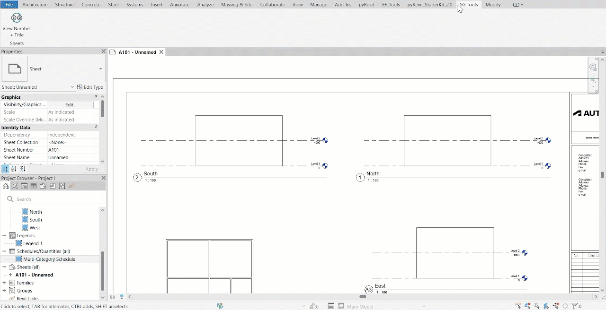
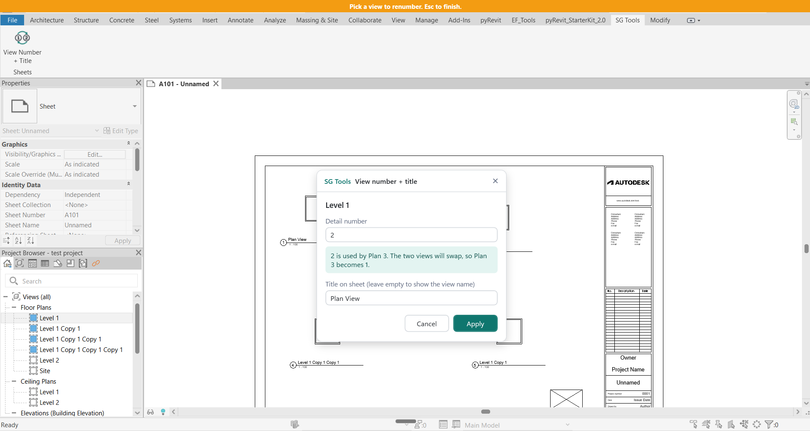
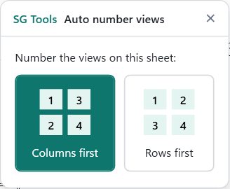

# SG Tools (pyRevit)

A pyRevit extension of Revit tools for architectural and structural modelling. I'm building it to learn the Revit API, one small tool at a time.

Each tool here is rebuilt in C# in [sg-csharp-tools](https://github.com/sonusgeorge/sg-csharp-tools).

## Tools

### View Number + Title

**Ribbon:** SG Tools tab, Sheets panel

**The problem.** Revit won't let two views on a sheet share a Detail Number. To put the views on a sheet in order you have to park one view on a throwaway number, renumber the next, and come back to the first. On a sheet with six or eight views that turns into a long chain of temporary numbers.

**What the tool does.** Pick a view on the sheet and type its new number. If another view already has that number, the two swap, and the tool handles the temporary number itself. The same box also changes the view's Title on Sheet.

**How to use it**

1. Open a sheet and click **View Number + Title**.
2. Click a view on the sheet.
3. Type the new number, the new title, or both. A notice tells you before you apply if the number belongs to another view and the two will swap.
4. Press Enter to apply. The tool goes straight back to waiting for the next view.
5. Press Esc when you're done.

Each change is one undo step, so Ctrl+Z takes back one view at a time.

**Good to know**

- Legends have no Detail Number, so for a legend the number field is greyed out and only the title can be changed.
- Leaving Title on Sheet empty shows the view's own name on the sheet.
- Revit treats `1` and `01`, and `a1` and `A1`, as different numbers, so the tool does too.

**Tested in:** Revit 2027, in full. Also run in Revit 2024, where it works, though without the full round of tests. Written to be compatible with Revit 2025 and 2026, but not yet run in them.

**What building it taught**

- The thing you click on a sheet is a `Viewport`, a separate element that places a view on a sheet. It is not the view itself.
- Revit has two parameters both shown as "Detail Number". Only `VIEWPORT_DETAIL_NUMBER` can be changed; its twin `VIEWER_DETAIL_NUMBER` is read-only. Code has to use the internal name, because the visible name doesn't say which one you get.
- Code can only change a Revit model inside a transaction, and each transaction is one entry in the Undo list. Keeping related changes in one transaction also means a failed change undoes the others.
- When Revit rejects a value it doesn't raise an error. It returns `False` and may show its own pop-up, so the code has to check the value first.
- A selection filter decides what the user is allowed to click, which also protects the rest of the code from elements it can't handle.
- A window is described in XAML, a layout file with no logic, and the Python class behind it supplies the behaviour. The shared colours and styles live in one file so every tool looks the same.
- The Python class behind the window inherits from pyRevit's `WPFWindow`, which already knows how to load and show a XAML file. Names given with `x:Name` become attributes in Python, and events such as `Click` and `TextChanged` call Python methods by name, so a typo on either side stops the window from opening.
- Setting a colour isn't enough to change how a button looks. Windows' own button template paints its own light blue on hover and ignores the colour you set, so the shared styles replace the template with a rounded border that takes its colours from the button.
- Order matters when a window opens. The shared styles have to be loaded before the layout that uses them, and filling the number field already fires its `TextChanged` event, so everything that event needs has to be stored first.
- Rebuilding the tool on a separate git branch kept the working version on `main` while the new one grew, one tested commit at a time.

### Auto Number Views

**Ribbon:** SG Tools tab, Sheets panel

**The problem.** Once views have been placed and moved around a sheet, their Detail Numbers rarely follow the layout. Putting them back in reading order by hand means renumbering every view, one at a time, with temporary numbers in between.

**What the tool does.** One click numbers every view on the open sheet 1, 2, 3… by where it sits. You choose the reading order: columns first or rows first.

**How to use it**

1. Open a sheet and click **Auto Number Views**.
2. Click **Columns first** (each column top to bottom, columns left to right) or **Rows first** (each row left to right, rows top to bottom).
3. A message in the corner of Revit says how many views were numbered.

All the changes are one undo step.

**Good to know**

- Legends and schedules are skipped. They have no Detail Number.
- Numbering always starts at 1.
- The box remembers your last choice and highlights it, so Enter repeats it.
- If the views are already in order, nothing is changed and nothing is added to the Undo list.
- A view joins a column when its centre falls within the width of the first view in that column (for rows, within its height). On an uneven layout the grouping can differ from what you'd expect, so check the result.

**Tested in:** Revit 2024 and Revit 2027, in full. Written to be compatible with Revit 2025 and 2026, but not yet run in them.

**What building it taught**

- A viewport reports its box on the sheet through `GetBoxCenter()` and `GetBoxOutline()`. The values are sheet coordinates in feet, with y pointing up, so "top to bottom" means sorting from the highest y to the lowest. The box doesn't include the view's title.
- `GetAllViewports()` doesn't return schedules, because a schedule on a sheet is a different element. Legends do come back, but with an empty Detail Number, so keeping only views that have a number skips both.
- Renumbering every view at once takes two passes: first every view gets a temporary number, then each gets its new one. In one pass, two views would share a number for a moment and Revit would refuse.
- Code that two tools need goes in the extension's `lib` folder. Reading a Detail Number and setting it safely moved out of View Number + Title into `sgtools/viewports.py`, and both tools now import it.
- pyRevit can remember a setting between runs with `script.get_config()`, `set_option()` and `script.save_config()`.
- Checking before changing anything means a run that has nothing to do doesn't leave an empty step in the Undo list.
- In `try` / `except` / `else`, the `else` part runs only if nothing went wrong, which makes it the place for the success message.
- Updating to pyRevit 7 changed how buttons are read. Its new loader ignores a plain docstring, so the tooltip is now written as `__doc__ = """..."""`. With that change, View Number + Title shows its tooltip text and video together.

## Install

1. Install [pyRevit](https://github.com/pyrevitlabs/pyRevit).
2. Download or clone this repository.
3. In Revit, open the pyRevit tab, then Settings, and add the downloaded folder under Custom Extension Directories.
4. Save the settings and reload pyRevit. The **SG Tools** tab appears on the ribbon.

## How these tools are made

I plan each tool and decide how it should behave, and an AI assistant (Claude) helps with the code: it explains each piece, and I type it in myself, one small piece at a time, testing in Revit as I go. I don't move on until I can explain what every part does. The first version of View Number + Title was written by the assistant; I then rebuilt it from scratch this way, because I learned far more by building it myself. Auto Number Views was built this way from the start. Each tool goes through the same steps: plan, research, outline, code, explain, polish, stress-test, ship. The steps are adapted from Erik Frits's PROCESS framework for pyRevit tools.
